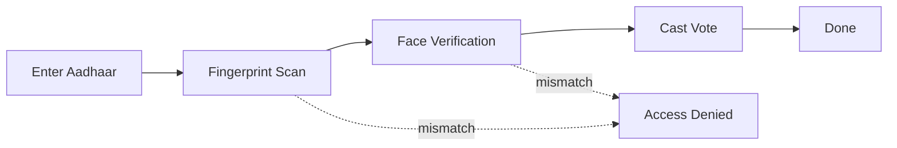
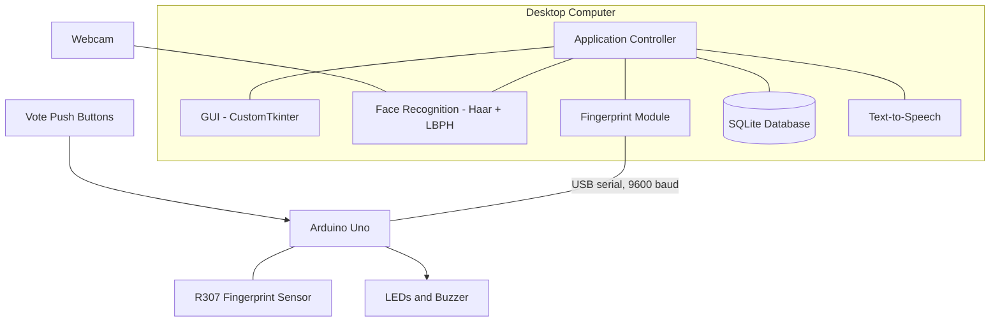

# 🗳️ Smart Voting System

**AI-powered, dual-factor biometric voting platform** that uses fingerprint scanning and face recognition to make elections secure, tamper-proof and fully offline.


---

## 📑 Table of Contents

- [Overview](#-overview)
- [Features](#-features)
- [How It Works](#-how-it-works)
- [System Architecture](#-system-architecture)
- [Hardware Requirements](#-hardware-requirements)
- [Software Requirements](#-software-requirements)
- [Installation](#-installation)
- [Usage](#-usage)
- [Project Structure](#-project-structure)
- [Security](#-security)
- [Technology Stack](#-technology-stack)
- [Troubleshooting](#-troubleshooting)

---

## 📖 Overview

The Smart Voting System prevents voter impersonation and duplicate voting by requiring **both** a matching fingerprint **and** a matching live face before a vote can be cast. A Python desktop application talks to an Arduino-based hardware unit (fingerprint sensor, push buttons, LEDs and buzzer) over USB serial. All data stays on the local machine, so no internet connection is needed.

## ✨ Features

| Feature | Description |
| --- | --- |
| **Face Recognition** | LBPH machine-learning algorithm identifies voters in real time |
| **Fingerprint Scan** | Arduino-connected sensor enrolls and verifies voters |
| **Dual Biometric Auth** | Fingerprint and face must both match before voting is allowed |
| **Anti-Spoofing** | Face verification is blocked if more than one face is in frame |
| **Voter Registration** | Captures face and fingerprint and saves them to a local database |
| **Vote Recording** | Votes stored in SQLite with a timestamp; double voting is blocked |
| **Authority Access** | Password-protected admin screens with brute-force lockout |
| **Session Locking** | Only one voting session can be active at a time |
| **Voice Feedback** | Offline text-to-speech announces a successful vote |
| **Offline Operation** | No internet required; fully local |

## 🔄 How It Works



If any step fails, the process stops and the voter is denied. The voting screen appears only when **both** biometric checks pass.

## 🏗️ System Architecture



## 🔧 Hardware Requirements

- Arduino Uno
- Adafruit R307 (or compatible) fingerprint sensor
- 4 push buttons for voting
- Green LED, Red LED and a buzzer
- USB cable (Arduino to PC)
- Webcam

## 💻 Software Requirements

- Python **3.10 or above**
- `customtkinter` — modern UI framework
- `opencv-contrib-python` — face detection and recognition
- `Pillow` — image processing
- `pyttsx3` — text-to-speech
- `pyserial` — Arduino communication
- SQLite3 — built into Python, no install needed

## 🚀 Installation

### 1. Install Python libraries

```bash
pip install customtkinter opencv-contrib-python pillow pyttsx3 pyserial
```

### 2. Upload the Arduino code

1. Open the **Arduino IDE**.
2. Open `arduino_voting.ino`.
3. Go to **Tools → Manage Libraries** and install **Adafruit Fingerprint Sensor Library**.
4. Select board **Arduino Uno** and the correct COM port.
5. Click **Upload**.

### 3. Run the app

Double-click **`Run App.bat`**. No terminal or code editor is needed.

Or from the command line:

```bash
python main.py
```

## 📘 Usage

### Register a voter *(authority only)*

1. Click **Register Voter** and enter the authority password.
2. Enter **Name**, **Aadhaar Number** and **Voter ID**.
3. Click **Scan Fingerprint & Register**; the voter places a finger on the sensor twice.
4. On the face capture screen, press **SPACE** 20 times to capture face photos.
5. The voter is saved and the face model is trained automatically.

### Cast a vote

1. Click **Vote** and enter your 12-digit Aadhaar number.
2. Place your finger on the sensor.
3. Look at the camera for face verification.
4. Once verified, press the party button on the Arduino device.
5. A voice message confirms that voting is done.

### Check eligibility

Click **Check Eligibility**, enter your Aadhaar number, and the system shows your name, voter number and voting status.

### Manage voters *(authority only)*

Search a voter by Aadhaar number, then edit or delete the record. Deleting a voter also removes their fingerprint from the sensor.

### Reset the election *(authority only)*

Click **Reset Election**, enter the password and confirm. All votes are cleared, but voter registrations are kept so the same voters can take part in the next election.

## 📂 Project Structure

```
Smart-Voting-System/
├── main.py              # Main application: all screens and UI
├── fingerprint.py       # Fingerprint functions: enroll, verify, delete
├── arduino_voting.ino   # Arduino code: fingerprint sensor + voting buttons
├── voting.db            # SQLite database with voter data
├── model.yml            # Trained face recognition model
├── dataset/             # Voter face images
└── Run App.bat          # Double-click launcher
```

## 🔐 Security

- **Dual-factor biometrics:** a stolen fingerprint ID or a photograph alone cannot cast a vote.
- **Anti-spoofing:** verification is blocked when more than one face is detected.
- **Authority protection:** register, manage, voter list and reset screens require a password, with a 30-second lockout after three failed attempts.
- **Session locking:** a second voter cannot start while a session is active.
- **Local data only:** no network dependency, which reduces the attack surface.

> ⚠️ **Change the default authority password (`1234`) before deployment.**

### Authority-protected screens

| Screen | Purpose |
| --- | --- |
| Register Voter | Add new voters |
| Manage Voters | Edit or delete voter records |
| Voter List | View all voters and their voting status |
| Reset Election | Clear all votes for a new election |

## 🧠 Technology Stack

| Technology | Role |
| --- | --- |
| **LBPH Face Recognition** | Trains on voter face data and identifies voters in real time |
| **OpenCV Haar Cascade** | Detects faces for capture and verification |
| **Adafruit Fingerprint** | Enrolls and matches fingerprints stored in sensor memory |
| **SQLite** | Stores voter records, fingerprint IDs and voting status offline |
| **Arduino Serial Comm** | Python and Arduino talk over USB serial at 9600 baud |
| **pyttsx3** | Offline text-to-speech for vote confirmation |

## 🛠️ Troubleshooting

| Problem | Solution |
| --- | --- |
| App closes immediately on launch | Add `pause` to `Run App.bat` and read the error message |
| Camera not opening | Close any other app that is using the camera |
| Face not recognised | Re-register the voter with better lighting |
| Arduino not connecting | Check the port is `COM3` and that `pyserial` is installed |
| Fingerprint not matching | Clean the sensor and try again slowly |
| "Already voted" error | Use **Reset Election** to clear votes while testing |
| Multiple faces warning | Make sure only the voter is in front of the camera |
